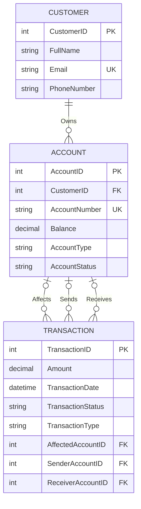
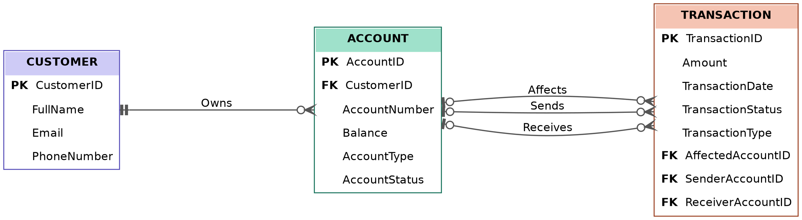

# Mini Banking Database

Relational database design for a small banking system, built with **SQL Server (T-SQL)**. The project focuses on data modeling, relationships, transaction design, and data integrity rather than on a full application.

## Entity Relationship Diagram

## Schema Design

| Entity | Role | Key constraints |
|---|---|---|
| **Customer** | Who owns accounts | `PK CustomerID`, unique `Email` |
| **Account** | Holds a balance | `PK AccountID`, unique `AccountNumber`, `FK CustomerID`, `Balance DEFAULT 0` |
| **Transaction** | Records money movement | `PK TransactionID`, `Amount > 0`, `TransactionType IN (Deposit, Withdrawal, Transfer)` |

## Relationships

| Relationship | Cardinality | Implemented by |
|---|---|---|
| **Owns** (Customer → Account) | 1 : 0..N | `Account.CustomerID` |
| **Affects** (Account → Transaction) | 1 : 0..N | `Transaction.AffectedAccountID` |
| **Sends** (Account → Transaction) | 1 : 0..N | `Transaction.SenderAccountID` |
| **Receives** (Account → Transaction) | 1 : 0..N | `Transaction.ReceiverAccountID` |

## Transaction Modeling

A transfer involves two accounts playing different roles, so a single `AccountID` column is not enough. Each role gets its own foreign key, all referencing `Account.AccountID`. A transfer is stored as **one record** that references both accounts.

| Type | `AffectedAccountID` | `SenderAccountID` | `ReceiverAccountID` |
|---|---|---|---|
| Deposit / Withdrawal | required | `NULL` | `NULL` |
| Transfer | `NULL` | required | required (≠ sender) |

This rule is enforced at the database level with a `CHECK` constraint, so invalid combinations cannot be inserted.

## Data Integrity

- Primary keys on every entity, foreign keys on every relationship.
- `UNIQUE` on `Email` and `AccountNumber`; `DEFAULT 0` on `Balance`.
- `CHECK` constraints for amount, transaction type, and role consistency.

## Future Improvements

- Execute transfers inside one database transaction (atomic debit + credit).
- Prevent overdrafts and handle concurrent balance updates.
- Add stored procedures for deposit, withdrawal, and transfer.
- Support joint accounts (Customer–Account as many-to-many).

## Schema

